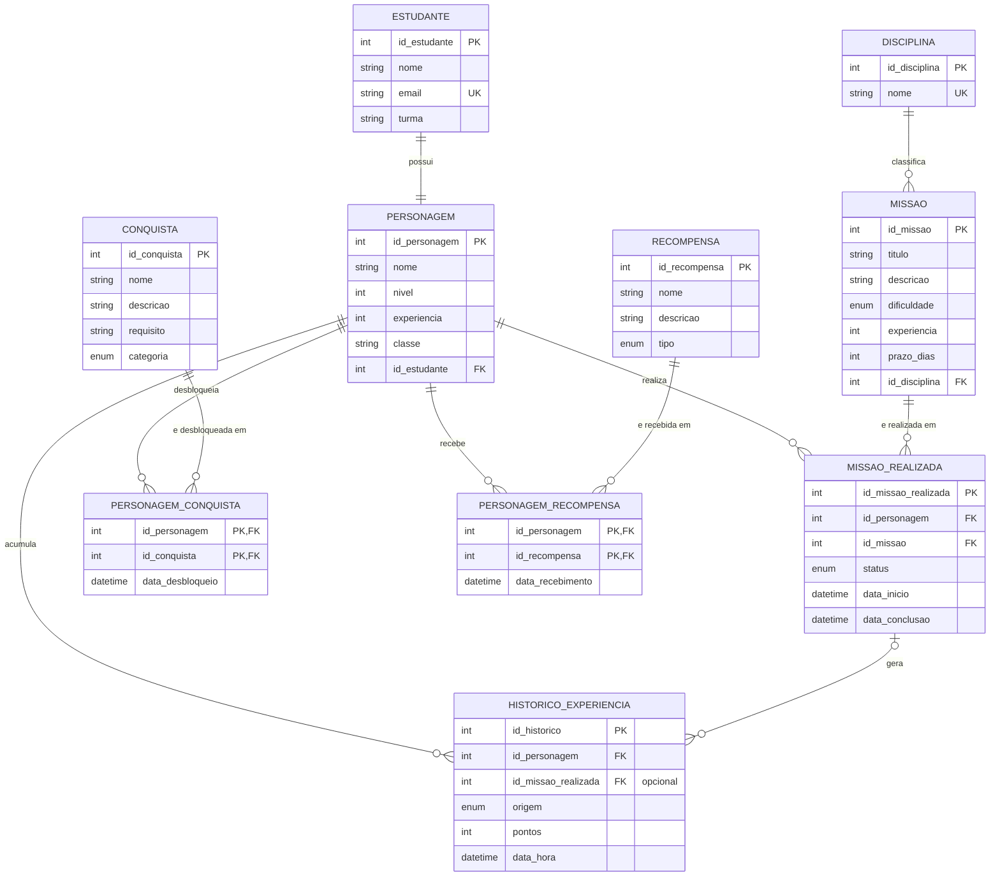

# Evolução do Projeto e Documentação

### Sistema de Gamificação Escolar: RPG da Escola


## 1. Identificação

- **Estudo de caso:** RPG da Escola (gamificação escolar)
- **Grupo:** Aleff Lohan; Anny Beatriz; Elis Vitória; Keyty Winslet
- **Disciplina / turma:** Banco de Dados / 2V InfoWeb
- **SGBD:** MySQL 8.0.16 ou superior
- **Banco de dados:** `rpg_escola`
- **Quantidade de tabelas:** 10

## 2. Sobre o projeto

O RPG da Escola é um sistema de gamificação escolar desenvolvido para tornar a realização das atividades e desafios escolares mais dinâmica e motivadora para os estudantes. A proposta é utilizar elementos de um jogo de RPG para representar o progresso dos alunos. Cada estudante terá um personagem, que poderá ganhar experiência, subir de nível, realizar missões, desbloquear conquistas e receber recompensas. O sistema será utilizado no ambiente escolar para acompanhar a participação e a evolução dos estudantes nas atividades propostas.

## 3. Objetivo

O principal objetivo do sistema é incentivar os estudantes a participarem das atividades escolares por meio de uma experiência baseada em gamificação. Através do sistema, será possível acompanhar as missões realizadas, as conquistas desbloqueadas, as recompensas recebidas e a experiência acumulada por cada personagem, inclusive **ao longo do tempo**, graças ao histórico de experiência.

## 4. Problema atendido

A realização de atividades escolares pode ser pouco motivadora para alguns estudantes. O sistema busca tornar esse processo mais interessante por meio de elementos de RPG, permitindo que os estudantes acompanhem sua própria evolução e tenham objetivos dentro da plataforma.

## 5. Cenário de utilização

O sistema pode ser utilizado por escolas para acompanhar e incentivar estudantes que participam de atividades e desafios escolares. Cada estudante será cadastrado no sistema e terá um personagem associado. As atividades e desafios serão cadastrados como missões, organizadas por **disciplina**, que poderão ser realizadas pelos personagens.

## 6. Principais características

- Cadastro de estudantes;
- Criação de personagens;
- Cadastro de missões por disciplina, com dificuldade, XP e prazo;
- Realização de missões, com registro de data de início, data de conclusão e status;
- Sistema de experiência e níveis, com histórico de cada ganho ou perda de XP;
- Desbloqueio de conquistas, com categoria;
- Recebimento de recompensas;
- Registro das datas de conquistas e recompensas;
- Ranking baseado na experiência dos personagens (geral ou por período);
- Relatórios por período, disciplina e cumprimento de prazos.

## 7. Banco de dados

O banco é formado por 10 tabelas: `estudante`, `personagem`, `disciplina`, `missao`, `conquista`, `recompensa`, `missao_realizada`, `personagem_conquista`, `personagem_recompensa` e `historico_experiencia`. O ranking **não** é armazenado em tabela própria: a posição é calculada por `ORDER BY experiencia` (geral) ou pela soma de `pontos` do histórico (por período).

### 7.1. Entidades e atributos

**ESTUDANTE:** `id_estudante` (PK), `nome`, `email` (único), `turma`

**PERSONAGEM:** `id_personagem` (PK), `nome`, `nivel`, `experiencia`, `classe`, `id_estudante` (FK, único, obrigatório)

**DISCIPLINA** *(nova)*: `id_disciplina` (PK), `nome` (único)

**MISSAO:** `id_missao` (PK), `titulo`, `descricao`, `dificuldade` (Fácil, Média, Difícil, Lendária), `experiencia`, `prazo_dias` *(novo)*, `id_disciplina` (FK, *novo*)

**CONQUISTA:** `id_conquista` (PK), `nome`, `descricao`, `requisito`, `categoria` *(nova: Missões, Disciplina, Progressão)*

**RECOMPENSA:** `id_recompensa` (PK), `nome`, `descricao`, `tipo` (Nota, Privilégio, Item Físico)

**MISSAO_REALIZADA:** `id_missao_realizada` (PK), `id_personagem` (FK), `id_missao` (FK), `status` (Em Andamento, Concluída, Falhou), `data_inicio`, `data_conclusao` *(nova, nula enquanto em andamento)*

**PERSONAGEM_CONQUISTA:** `id_personagem` (PK/FK), `id_conquista` (PK/FK), `data_desbloqueio`

**PERSONAGEM_RECOMPENSA:** `id_personagem` (PK/FK), `id_recompensa` (PK/FK), `data_recebimento`

**HISTORICO_EXPERIENCIA** *(nova)*: `id_historico` (PK), `id_personagem` (FK), `id_missao_realizada` (FK, opcional), `origem` (Missão, Conquista, Bônus, Penalidade), `pontos`, `data_hora`

### 7.2. Relacionamentos e cardinalidade

- **Estudante e Personagem (1:1):** cada estudante possui um único personagem e cada personagem pertence a um único estudante. A FK `id_estudante` é `UNIQUE` e `NOT NULL`.
- **Disciplina e Missão (1:N):** uma disciplina tem várias missões; cada missão pertence a uma disciplina.
- **Personagem e Missão (N:N):** um personagem pode realizar várias missões e uma missão pode ser realizada por vários personagens. A entidade associativa `missao_realizada` tem chave própria (permitindo repetir uma missão) e guarda `status`, `data_inicio` e `data_conclusao`.
- **Personagem e Conquista (N:N):** resolvida por `personagem_conquista`, que registra a data do desbloqueio.
- **Personagem e Recompensa (N:N):** resolvida por `personagem_recompensa`, que registra a data de recebimento.
- **Personagem e Histórico de Experiência (1:N):** cada ganho ou perda de XP pertence a um personagem.
- **Missão Realizada e Histórico de Experiência (0..1:N):** o lançamento de XP pode ou não ter sido gerado por uma missão (bônus de conquista e bônus avulsos não têm missão). Se a missão realizada for excluída, o histórico é preservado (`ON DELETE SET NULL`).

### 7.3. DER atualizado



## 8. Regras de negócio

1. Cada estudante deve possuir um único personagem, e cada personagem pertence a um único estudante.
2. O e-mail do estudante é único.
3. Um personagem pode realizar várias missões, e uma missão pode ser realizada por vários personagens.
4. Cada realização de missão deve registrar a data de início e o status.
5. Uma missão só será considerada concluída quando seu status indicar que foi finalizada; nesse caso a data de conclusão é obrigatória e não pode ser anterior à data de início. Uma missão em andamento não tem data de conclusão.
6. Uma missão concluída está **no prazo** quando a diferença em dias entre conclusão e início é menor ou igual ao `prazo_dias` da missão.
7. Ao concluir uma missão, o XP da missão é lançado no histórico e somado à experiência do personagem. O nível é calculado a partir do XP (nível = XP div 250 + 1).
8. Ao marcar uma falha, o sistema poderá registrar uma penalidade de 10 pontos, sem deixar o XP negativo.
9. Um personagem pode desbloquear várias conquistas, e uma conquista pode ser desbloqueada por vários personagens, mas apenas uma vez por personagem. Cada desbloqueio concede 50 pontos de bônus no histórico.
10. Um personagem pode receber várias recompensas, e uma recompensa pode ser recebida por vários personagens, uma única vez por personagem.
11. A posição do ranking é calculada com base na experiência acumulada (geral) ou na soma dos pontos do histórico (por período).
12. O histórico de experiência é preservado: correções são feitas com novos lançamentos, e não por edição ou exclusão.

## 9. O que mudou nesta etapa

| Modificação | Justificativa |
| --- | --- |
| Nova tabela `disciplina` e `missao.id_disciplina` | Relatórios por matéria e conquistas por área |
| `missao.prazo_dias` | Saber se a missão foi concluída no prazo |
| `missao_realizada`: `data_registro` vira `data_inicio`; novo `data_conclusao`; `CHECK` entre status e datas | Consultas por período e tempo de conclusão |
| Nova tabela `historico_experiencia` | Preservar a evolução do XP e permitir ranking por período |
| `conquista.categoria` e `recompensa.tipo` em ENUM | Agrupamentos padronizados |
| `personagem.id_estudante` `NOT NULL`; `CHECK` em nível e experiência | Garantir o 1:1 e valores válidos |
| Datas em `DATETIME`; índices em consultas temporais | Registrar hora e acelerar filtros por período |

**Mantido:** ranking calculado (sem tabela própria) e tabelas associativas de conquistas e recompensas. A análise completa e as justificativas estão no [relatorios.pdf](relatorios.pdf).

## 10. Massa de dados

| Tabela | Registros |
| --- | --- |
| `estudante` | 2.000 |
| `disciplina` | 8 |
| `personagem` | 2.000 |
| `missao` | 40 |
| `conquista` | 8 |
| `recompensa` | 6 |
| `missao_realizada` | 8.957 |
| `personagem_conquista` | 5.224 |
| `personagem_recompensa` | 2.106 |
| `historico_experiencia` | 13.130 |
| **Total** | **33.479** |

Os registros da etapa anterior (2.000 estudantes e personagens, 4 missões, 3 conquistas e 3 recompensas originais) foram mantidos em estrutura e quantidade, e a base foi ampliada com disciplinas, novas missões, conquistas e recompensas, missões realizadas e histórico de experiência. As datas se distribuem de fevereiro a novembro de 2026.

### Uso de Inteligência Artificial

Foi utilizada IA (Claude, da Anthropic) para propor a evolução do modelo e gerar o script que produz os comandos `INSERT`, que foi incorporado ao `database.sql`. A consistência foi verificada por consultas de validação: chaves estrangeiras, XP igual à soma do histórico, nível compatível com o XP, datas coerentes e valores únicos. [Grupo: confirmar e complementar.]

## 11. Relatórios propostos

As consultas completas estão em [`relatorios.sql`](relatorios.sql) e no [relatorios.pdf](relatorios.pdf).

| # | Relatório | Finalidade |
| --- | --- | --- |
| 1 | Ranking de personagens por XP em um período | Quais personagens mais evoluíram entre setembro e outubro de 2026, com turma e classe |
| 2 | Desempenho por disciplina | Tentativas, concluídas, falhas, taxa de conclusão e tempo médio por disciplina |
| 3 | Missões concluídas dentro e fora do prazo, por mês | Evolução mensal do cumprimento dos prazos |

## 12. Escopo previsto para a versão final em POO

- Cadastro, edição, listagem e exclusão de estudantes, personagens, missões, disciplinas, conquistas e recompensas.
- Realização de missões (iniciar, concluir, falhar), com cálculo de XP, nível e registro no histórico.
- Desbloqueio automático de conquistas e concessão de recompensas.
- Consulta de histórico, ranking (geral e por período), pesquisa e filtros.
- Os três relatórios acima, acessíveis pelo sistema.
- Evolução futura: perfis com login, loja de recompensas, notificações.

## 13. Arquivos do repositório

| Arquivo | Descrição |
| --- | --- |
| `README.md` | Esta documentação |
| `database.sql` | Cria o banco, as tabelas e as restrições e insere a massa de dados completa |
| `relatorios.sql` | Consultas dos três relatórios |
| [`relatorios.pdf`](relatorios.pdf) | Relatório de evolução do projeto (análise, DER, dados, relatórios e escopo em POO) |

## 14. Como executar o script SQL

```bash
# a partir de um servidor MySQL 8 (o script recria o banco rpg_escola)
mysql -u SEU_USUARIO -p < database.sql
# o script termina com uma tabela de conferência (registros por tabela e total)

# para executar os relatórios
mysql -u SEU_USUARIO -p < relatorios.sql
```

O `database.sql` apaga e recria as tabelas do banco `rpg_escola`, então não deve ser executado sobre dados que se queira manter.

## 15. Versionamento

```bash
git checkout main
git pull origin main
git checkout -b projeto-dados-final
git add .
git commit -m "Finaliza projeto de dados e relatorios"
git push -u origin projeto-dados-final
```