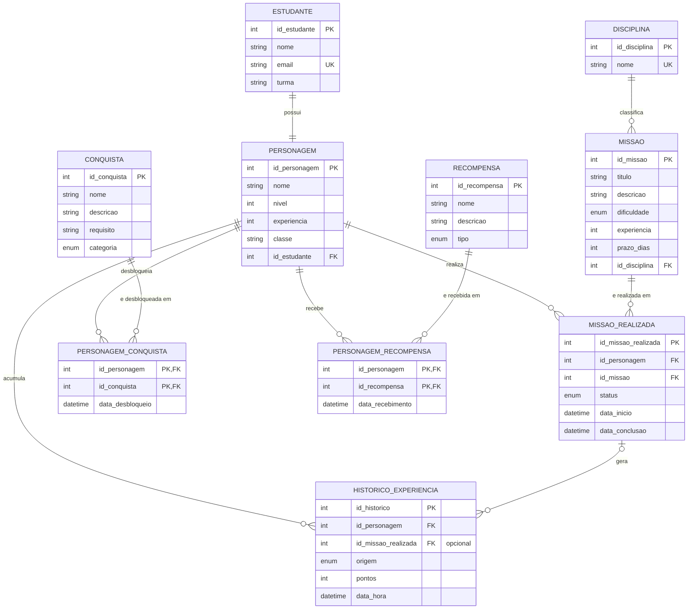

# DER atualizado: RPG da Escola

## Cardinalidades das novas relações

- **DISCIPLINA 1:N MISSAO**: cada missão pertence a uma disciplina; uma disciplina tem várias missões.
- **PERSONAGEM 1:N HISTORICO_EXPERIENCIA**: cada ganho ou perda de XP pertence a um personagem.