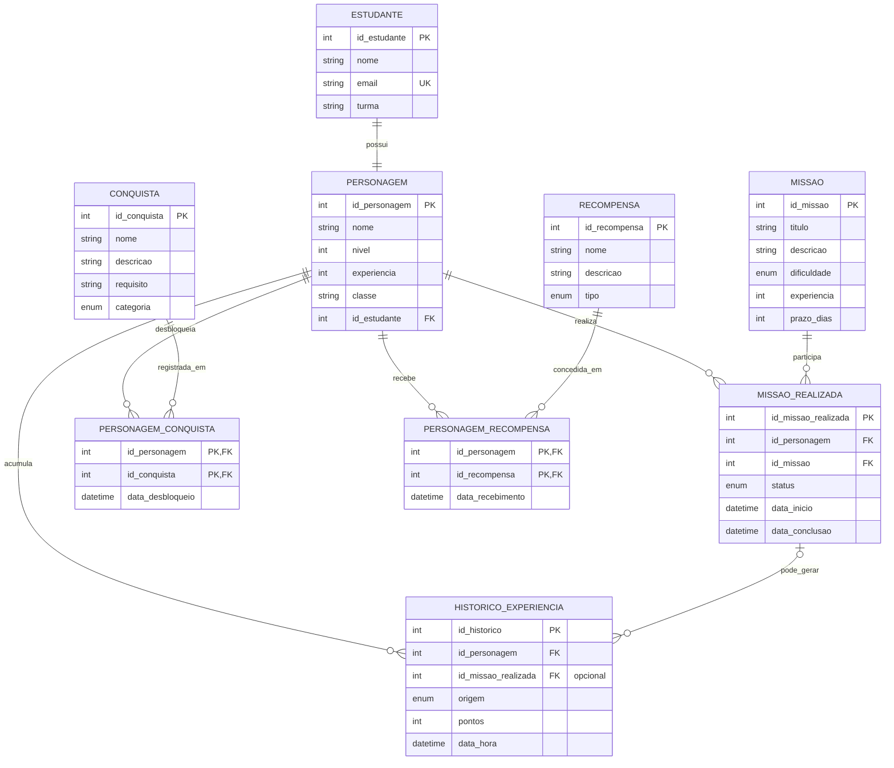

# DER atualizado — RPG da Escola

O diagrama representa a estrutura do banco `rpg_escola`, conforme o modelo implementado no script SQL.

## Diagrama Entidade-Relacionamento

## Entidades e atributos

- **ESTUDANTE:** `id_estudante` (PK), `nome`, `email` (único) e `turma`.
- **PERSONAGEM:** `id_personagem` (PK), `nome`, `nivel`, `experiencia`, `classe` e `id_estudante` (FK, UNIQUE e NOT NULL).
- **MISSAO:** `id_missao` (PK), `titulo`, `descricao`, `dificuldade`, `experiencia` e `prazo_dias`.
- **CONQUISTA:** `id_conquista` (PK), `nome`, `descricao`, `requisito` e `categoria`.
- **RECOMPENSA:** `id_recompensa` (PK), `nome`, `descricao` e `tipo`.
- **MISSAO_REALIZADA:** `id_missao_realizada` (PK), `id_personagem` (FK), `id_missao` (FK), `status`, `data_inicio` e `data_conclusao`.
- **PERSONAGEM_CONQUISTA:** chave primária composta por `id_personagem` e `id_conquista`, ambos também FKs; registra `data_desbloqueio`.
- **PERSONAGEM_RECOMPENSA:** chave primária composta por `id_personagem` e `id_recompensa`, ambos também FKs; registra `data_recebimento`.
- **HISTORICO_EXPERIENCIA:** `id_historico` (PK), `id_personagem` (FK), `id_missao_realizada` (FK opcional), `origem`, `pontos` e `data_hora`.

## Relacionamentos e cardinalidades

| Relacionamento | Cardinalidade | Implementação |
|---|---|---|
| Estudante — Personagem | 1:1 no modelo | `personagem.id_estudante` é FK, UNIQUE e NOT NULL. |
| Personagem — Missão | N:N | Resolvido por `missao_realizada`, com chave própria que permite registrar tentativas. |
| Personagem — Conquista | N:N | Resolvido por `personagem_conquista`, com chave primária composta. |
| Personagem — Recompensa | N:N | Resolvido por `personagem_recompensa`, com chave primária composta. |
| Personagem — Histórico de experiência | 1:N | Cada lançamento de XP pertence a um personagem. |
| Missão realizada — Histórico de experiência | 0..1:N | O lançamento de XP pode ou não estar associado a uma missão realizada. |

## Observações

- `id_estudante` em `personagem` é `UNIQUE` e `NOT NULL`, impedindo mais de um personagem por estudante e personagens sem estudante. A criação de um personagem para todo estudante deve ser garantida pelo fluxo da aplicação.
- `id_missao_realizada` em `historico_experiencia` aceita `NULL`, pois bônus e penalidades podem não estar vinculados a uma missão.
- A exclusão de uma missão realizada utiliza `ON DELETE SET NULL` na FK do histórico, preservando o lançamento de experiência.
- O script requer MySQL 8.0.16 ou superior para que as restrições `CHECK` sejam aplicadas.
